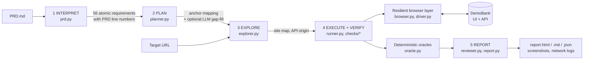

# DemoBank Spec-Driven QA Agent

**Walkthrough video:** https://drive.google.com/file/d/1PxTKRBGr_zWmoEVuAuORu7aB0zztxaq4/view?usp=sharing
**QA audit report:** [audit-report/report.md](audit-report/report.md)
Audit run against the kit's local DemoBank (test-website/LOCAL_SETUP.md); no hosted URL was provided.

An autonomous QA agent that reads a product requirements document (PRD), exercises a live web application in a real browser, and reports, requirement by requirement, whether the application does what the specification says, with reproducible evidence for every verdict.

Built for the CDF Agentic QA Hackathon against the DemoBank target.

```
python -m qa_agent --url <frontend URL> --prd ../test-website/PRD.md
```

## What it produces

Each run creates `runs/<timestamp>/` containing:

| File | Contents |
|---|---|
| `report.html` | The audit report: scoreboard, defect register with reproduction steps and screenshots, requirement traceability matrix, per-check assertions, exploration site map, cost breakdown, side effects, limitations |
| `report.md` | The same audit in Markdown (renders on GitHub) |
| `results.json` | Machine-readable results for every requirement, check, assertion and defect |
| `requirements.json` | The 56 atomic requirements extracted from the PRD, with their PRD line numbers and mapped checks |
| `screenshots/` | Evidence captured at each significant step and at every failed assertion |
| `network/<check>.json` | Full API traffic for each check (method, URL, status, request body, JSON response) |
| `traces/` | Playwright traces per check when run with `--trace` (open with `python -m playwright show-trace`) |

## Architecture



The pipeline follows the hackathon's autonomous QA loop: interpret, plan, execute, verify, report.

### 1. Interpret (`qa_agent/prd.py`)

The PRD is parsed deterministically into atomic requirements. Every sentence in a behavioural section becomes one requirement with a stable ID (`REQ-XFER-08`), its section, and the PRD line it came from. Requirement text is kept verbatim, so the audit trail can be checked against the specification word for word. Parsing costs nothing and gives the same result every time.

### 2. Plan (`qa_agent/planner.py`)

Each check declares the PRD phrases it verifies (its *anchors*). Requirements are mapped to checks by matching those anchors. If any requirement is left unmapped (for example, after the PRD changes), it is offered to the LLM together with the check catalogue. The LLM may assign existing checks or explain why the statement cannot be verified through the UI. Anything still unmapped is reported as **unverified** with a reason; nothing is silently dropped.

### 3. Explore (`qa_agent/explorer.py`)

Before testing, the agent walks the application breadth-first from the landing page and dashboard. It records each page's heading, buttons, inputs and a screenshot, and discovers the API origin from live network traffic. Destructive controls (Log out, form submits) are never clicked during exploration.

### 4. Execute and verify (`qa_agent/runner.py`, `qa_agent/checks/`)

53 checks cover normal, negative and edge-case behaviour across access, accounts, transfers, history, profile, interface, safety and scope. Each check:

* runs in a **fresh browser context** (new demo session), so no state leaks between scenarios and every verdict is reproducible on its own;
* records numbered **steps** and named **assertions** (expected vs. observed), with a screenshot for every failure;
* checks **side effects**, not just clicks. A transfer passes only if the server committed exactly one record and both balances moved by exactly the amount.

**Deterministic oracles decide every verdict** (`qa_agent/oracle.py`): exact `Decimal` money parsing, Pacific-time calendar conversion (the page states its dates use Pacific Time), and filter expectations. For history filters, the expected row set is computed independently from the unfiltered history and compared row by row with the filtered view. This catches both extra rows and missing rows.

### 5. Report (`qa_agent/reviewer.py`, `qa_agent/report.py`)

Failing checks are grouped into a defect register (`BUG-01`…), ordered by severity. Each defect includes requirements, steps to reproduce, expected vs. observed values and screenshots. When an API key is available, one LLM call clusters failures that share a root cause and adds impact notes and a summary. The LLM **cannot change a verdict**.

## Design decisions that matter for the rubric

**Accuracy and few false positives (30%).**
* Agent problems are never reported as product failures. If a control cannot be found or the agent times out, a read-only check is retried once in a fresh session; otherwise it is reported **unverified** with the reason and a screenshot.
* Money checks compare server state before and after the action. Transactions created by *other users* during the check (the hosted target is shared) are identified and subtracted, so concurrent activity cannot create a false failure.

**Verification rigor (25%).**
* Every transfer rule is tested with valid, invalid and boundary inputs:
  * a valid transfer (also with no memo);
  * same-account, blank, `0`, `0.00`, `-5.00`, `abc` and `10.005`;
  * balance + $0.01 (must be rejected) and exactly the balance (must be allowed).
* The double-submit guard is tested with 1.5 s of injected network latency.
* Server errors and network drops are injected to test the "not completed" path and retry.
* Date filters are tested at both boundaries, including a transaction whose UTC date differs from its Pacific date.
* Logout is verified both in the UI and on the server, by replaying the pre-logout session cookie.

**Cost (20%).**
* The browser runs locally (free); the LLM is optional.
* With the default `claude-haiku-5-5`, a typical run makes one triage call. Exact token counts and cost are metered from the API's usage data and reported in every run.
* Responses are cached by content hash. Requirement-mapping answers depend only on the PRD, so reruns reuse them at $0. Triage is one call per run, because its input is that run's evidence.
* `--llm none` runs the full audit with zero API cost and identical verdicts.

**Autonomous resilience (15%).**
* **Layered locators.** Every control is found by a chain of strategies: test-id, ARIA role and name, label, visible text.
* **Self-healing.** If all strategies miss, the current ARIA snapshot is used to locate the intended control (by LLM, or by fuzzy matching offline). Every heal is logged in the report.
* **Settling instead of sleeps.** The agent waits for network idle, no visible "Loading/Submitting" text, and a stable DOM. It never relies on fixed sleeps.
* **Fresh session per check.** Each check runs in its own browser session; read-only checks are retried once.

Resilience was tested by running the agent against two altered builds of the real DemoBank frontend:

| Change to the UI | Result |
|---|---|
| Every `data-testid` attribute removed (a benign refactor) | Same verdicts as the original build on the affected checks (dashboard, transfers, history, profile, navigation). The semantic fallbacks took over. |
| "Enter Demo" button renamed to "Enter the demo" | Locator self-healed (logged as `'Enter Demo' healed to role=button name='Enter the demo'`), so dependent checks kept running and passed. C-ACC-01 still correctly **failed**, because the PRD requires a control labelled *Enter Demo*. |

Testing the test-id-free build also exposed (and led to fixing) a fallback that read the wrapper around both account cards as a third card. That would have been a false positive, which is why both builds are part of the agent's own test routine.

**Evidence and actionability (10%).**
* Every defect includes:
  * numbered reproduction steps;
  * observed values (for example, "New Everyday Checking balance −$0.01");
  * screenshots;
  * the full network log of the check.

**Safety on a shared target.**
* Test transfers use small amounts tagged with a run memo (`QA-XXXX`).
* Any money moved by a test, or by a defect, is returned with a compensating transfer, listed under *Side effects and cleanup*.
* No load testing; requests go only to the supplied app and its API.

## Setup and run

Step-by-step Windows instructions, with what you should see at each stage, are in [`docs/WINDOWS_SETUP.md`](docs/WINDOWS_SETUP.md). In short:

```bat
cd agent
python -m venv .venv
.venv\Scripts\activate
pip install -r requirements.txt
python -m playwright install chromium
python -m qa_agent --url http://localhost:5173 --prd ..\test-website\PRD.md
```

Optional LLM assistance: copy `.env.example` to `.env` and set `ANTHROPIC_API_KEY`.

| Option | Purpose |
|---|---|
| `--url` | Frontend URL (required) |
| `--prd` | Path to the PRD (required) |
| `--llm anthropic\|none\|mock` | LLM assistance; `none` = deterministic only, $0 |
| `--model` | Model id (default `claude-haiku-5-5`) |
| `--only C-XFER C-HIST` / `--skip ...` | Run a subset of checks by id prefix |
| `--headed --slowmo 300` | Visible, slowed-down browser for demos |
| `--trace` | Save a Playwright trace per check |
| `--no-explore` | Skip the exploration stage |

Unit tests (offline, no browser): `python -m unittest -v`

## Check catalogue

| Area | Checks | Covers |
|---|---|---|
| Access | C-ACC-01…08 | Enter Demo, header identity, refresh persistence, logout, direct navigation after logout, Back/refresh, server-side cookie revocation, fresh visitor |
| Accounts | C-DASH-01…05 | Checking + savings shown, card fields and 2-decimal USD, no full identifiers (UI and API), detail view consistency, UI = server balances |
| Seed data | C-SEED-01 | One customer, one checking, one savings, varied dates, types and statuses, an internal transfer |
| History | C-HIST-01…13 | Both views, row fields vs. API amounts, direction signs, each filter, combined filters, start/end/single-day inclusivity, empty state, clear filters, inverted range |
| Transfers | C-XFER-01…16 | Form, happy path and atomicity, history records, refresh, optional memo, same-account, six invalid amounts, insufficient funds, exact-balance boundary, double submit under latency, injected 500 / network drop and retry |
| Profile | C-PROF-01…02 | Masked details; no tokens, passwords, secrets or extra fields; HttpOnly session cookie |
| Interface | C-UI-01…06 | 1280×800, 768 and 390 px, accessible labels, navigation targets, recoverable errors with injected API failure, loading states |
| Safety / scope | C-SAFE-01, C-OOS-01 | No third-party hosts contacted; no out-of-scope features |

## Project layout

```
agent/
├── qa_agent/
│   ├── cli.py          # entry point, pipeline orchestration, preflight
│   ├── prd.py          # 1 interpret
│   ├── planner.py      # 2 plan
│   ├── explorer.py     # 3 explore
│   ├── runner.py       # 4 execute + aggregate to requirement verdicts
│   ├── browser.py      # resilient locators, self-healing, settling, evidence capture
│   ├── driver.py       # DemoBank skills: enter demo, read dashboard/history, filter, transfer
│   ├── oracle.py       # deterministic money / date / filter / ledger oracles
│   ├── reviewer.py     # defect grouping + optional LLM triage
│   ├── report.py       # HTML / Markdown / JSON reports
│   ├── llm.py          # metered, cached Claude client (stdlib only)
│   └── checks/         # 53 checks by area
├── tests/              # offline unit tests
├── docs/               # Windows setup, video script, submission checklist
├── run_agent.bat
└── requirements.txt
```

## Known limitations

* Behaviour that is neither visible in the UI nor in its HTTP responses (for example, the backend calling an external system) cannot be observed. C-SAFE-01 covers the browser side only.
* Date expectations use Pacific Time because the page states so; if the hint were absent the agent would still assume Pacific Time and note it as an assumption.
* Only Chromium is exercised.
* Compensating transfers restore balances, but the test transfers remain in transaction history as tagged records (`QA-XXXX`). On a local target, reset the database before each recorded run (see the setup guide).
