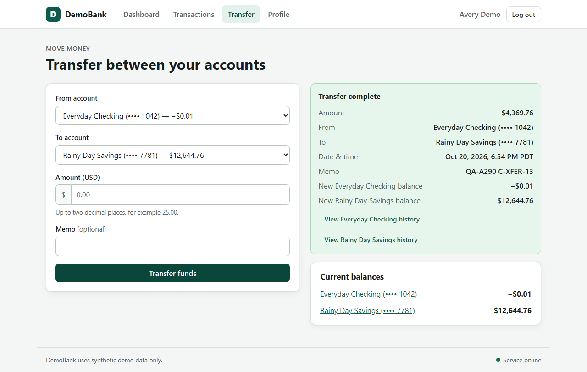
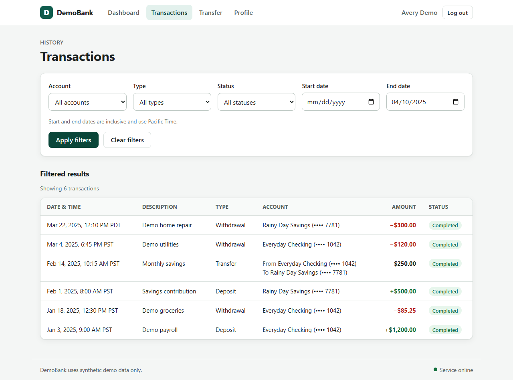
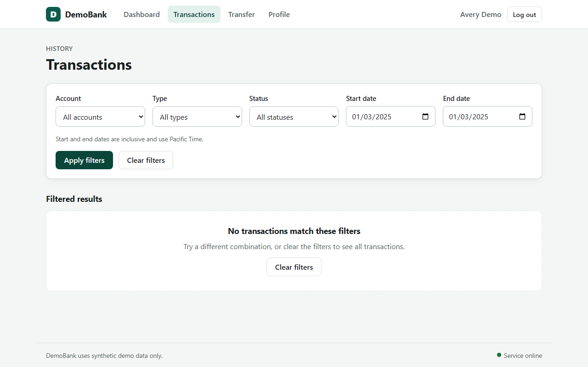
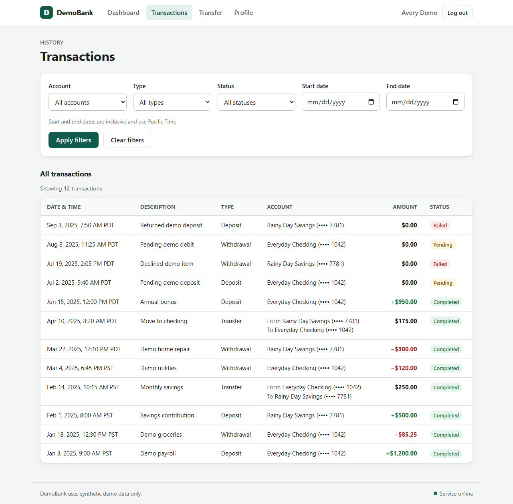

# QA Audit Report - http://localhost:5173

Run `20261020-215125` | 2026-10-21 01:56 UTC | 286.8 s | agent v1.0.0 | PRD sha256 `5bf675015f276b04` | LLM: none (none)

## Summary

48 of 56 PRD requirements passed, 8 failed and 0 could not be verified. 7 of 53 executed checks found discrepancies, grouped into 7 defect(s); most important: Not met: Transfer above the available balance is rejected (balance + $0.01), Not met: End date is inclusive (transaction ON the end date is listed), Not met: Single-day range (start = end) returns that day's transactions, Not met: Zero amount ('0') is rejected with a validation message and no side effects.

| | Passed | Failed | Unverified | Total |
|---|---:|---:|---:|---:|
| Requirements | 48 | 8 | 0 | 56 |
| Checks | 46 | 7 | 0 | 53 |
| Normal scenarios | 22 | 1 | 0 | 23 |
| Negative scenarios | 14 | 2 | 0 | 16 |
| Edge scenarios | 10 | 4 | 0 | 14 |

## Defects

### BUG-01 [CRITICAL] Not met: Transfer above the available balance is rejected (balance + $0.01)

- **Requirements:** REQ-XFER-08, REQ-XFER-09
- **Checks:** C-XFER-13
- **Confidence:** high (deterministic oracle)

**Steps to reproduce**

1. Enter the demo and open Transfer; choose From 'Everyday Checking', To 'Rainy Day Savings', Amount '4369.76', Memo 'QA-A290 C-XFER-13'
2. Click 'Transfer funds' and wait for the outcome
3. Open the Dashboard and compare balances with the values before the attempt

| Failed assertion | Expected (PRD) | Observed |
|---|---|---|
| insufficient funds: rejected with a clear message | visible validation / error message | no message (ui_state=success) |
| insufficient funds: no success state shown | no 'Transfer complete' | 'Transfer complete' with receipt New Everyday Checking balance: −$0.01; New Rainy Day Savings balance: $12,644.76 |
| insufficient funds: server did not accept the transfer | no 2xx from POST /api/transfers | 201 |
| insufficient funds: no transaction record created | 0 new records | transfer 4369.76 completed |
| insufficient funds: balances unchanged | no balance change | Rainy Day Savings=+4369.76, Everyday Checking=-4369.76 |

### BUG-02 [HIGH] Not met: End date is inclusive (transaction ON the end date is listed)

- **Requirements:** REQ-HIST-06, REQ-HIST-07
- **Checks:** C-HIST-09
- **Confidence:** high (deterministic oracle)

**Steps to reproduce**

1. End date = 2025-01-03
2. End date = 2025-04-10
3. End date = 2025-03-04

| Failed assertion | Expected (PRD) | Observed |
|---|---|---|
| end=2025-01-03: no matching transaction is missing | 1 row(s) | 0 row(s); missing: ['Jan 3, 2025, 9:00 AM PST | Demo payroll | Deposit | +$1,200.00 | Completed'] |
| end=2025-04-10: no matching transaction is missing | 7 row(s) | 6 row(s); missing: ['Apr 10, 2025, 8:20 AM PDT | Move to checking | Transfer | $175.00 | Completed'] |
| end=2025-03-04: no matching transaction is missing | 5 row(s) | 4 row(s); missing: ['Mar 4, 2025, 6:45 PM PST | Demo utilities | Withdrawal | −$120.00 | Completed'] |

### BUG-03 [HIGH] Not met: Single-day range (start = end) returns that day's transactions

- **Requirements:** REQ-HIST-06, REQ-HIST-07
- **Checks:** C-HIST-10
- **Confidence:** high (deterministic oracle)

**Steps to reproduce**

1. Range 2025-01-03 .. 2025-01-03
2. Range 2025-04-10 .. 2025-04-10
3. Range 2025-03-04 .. 2025-03-04

| Failed assertion | Expected (PRD) | Observed |
|---|---|---|
| 2025-01-03..2025-01-03: no matching transaction is missing | 1 row(s) | 0 row(s); missing: ['Jan 3, 2025, 9:00 AM PST | Demo payroll | Deposit | +$1,200.00 | Completed'] |
| 2025-04-10..2025-04-10: no matching transaction is missing | 1 row(s) | 0 row(s); missing: ['Apr 10, 2025, 8:20 AM PDT | Move to checking | Transfer | $175.00 | Completed'] |
| 2025-03-04..2025-03-04: no matching transaction is missing | 1 row(s) | 0 row(s); missing: ['Mar 4, 2025, 6:45 PM PST | Demo utilities | Withdrawal | −$120.00 | Completed'] |

### BUG-04 [HIGH] Not met: Zero amount ('0') is rejected with a validation message and no side effects

- **Requirements:** REQ-XFER-05, REQ-XFER-06, REQ-XFER-07
- **Checks:** C-XFER-08
- **Confidence:** high (deterministic oracle)

**Steps to reproduce**

1. Enter the demo and open Transfer; choose From 'Everyday Checking', To 'Rainy Day Savings', Amount '0', Memo 'QA-A290 C-XFER-08'
2. Click 'Transfer funds' and wait for the outcome

| Failed assertion | Expected (PRD) | Observed |
|---|---|---|
| zero: rejected with a clear message | visible validation / error message | no message (ui_state=success) |
| zero: no success state shown | no 'Transfer complete' | 'Transfer complete' with receipt New Everyday Checking balance: $4,369.75; New Rainy Day Savings balance: $8,275.00 |
| zero: server did not accept the transfer | no 2xx from POST /api/transfers | 201 |
| zero: no transaction record created | 0 new records | transfer 0.00 completed |

### BUG-05 [HIGH] Not met: Zero amount written as 0.00 ('0.00') is rejected with a validation message and no side effects

- **Requirements:** REQ-XFER-05, REQ-XFER-06, REQ-XFER-07
- **Checks:** C-XFER-09
- **Confidence:** high (deterministic oracle)

**Steps to reproduce**

1. Enter the demo and open Transfer; choose From 'Everyday Checking', To 'Rainy Day Savings', Amount '0.00', Memo 'QA-A290 C-XFER-09'
2. Click 'Transfer funds' and wait for the outcome

| Failed assertion | Expected (PRD) | Observed |
|---|---|---|
| zero with decimals: rejected with a clear message | visible validation / error message | no message (ui_state=success) |
| zero with decimals: no success state shown | no 'Transfer complete' | 'Transfer complete' with receipt New Everyday Checking balance: $4,369.75; New Rainy Day Savings balance: $8,275.00 |
| zero with decimals: server did not accept the transfer | no 2xx from POST /api/transfers | 201 |
| zero with decimals: no transaction record created | 0 new records | transfer 0.00 completed |

### BUG-06 [HIGH] Not met: Negative amount ('-5.00') is rejected with a validation message and no side effects

- **Requirements:** REQ-XFER-05, REQ-XFER-06, REQ-XFER-07
- **Checks:** C-XFER-10
- **Confidence:** high (deterministic oracle)

**Steps to reproduce**

1. Enter the demo and open Transfer; choose From 'Everyday Checking', To 'Rainy Day Savings', Amount '-5.00', Memo 'QA-A290 C-XFER-10'
2. Click 'Transfer funds' and wait for the outcome
3. Open the Dashboard and compare balances with the values before the attempt

| Failed assertion | Expected (PRD) | Observed |
|---|---|---|
| negative: rejected with a clear message | visible validation / error message | no message (ui_state=success) |
| negative: no success state shown | no 'Transfer complete' | 'Transfer complete' with receipt New Everyday Checking balance: $4,374.75; New Rainy Day Savings balance: $8,270.00 |
| negative: server did not accept the transfer | no 2xx from POST /api/transfers | 201 |
| negative: no transaction record created | 0 new records | transfer -5.00 completed |
| negative: balances unchanged | no balance change | Rainy Day Savings=-5.00, Everyday Checking=+5.00 |

### BUG-07 [MEDIUM] Not met: Every row shows date/time, description, type, account, amount and status

- **Requirements:** REQ-HIST-02
- **Checks:** C-HIST-02
- **Confidence:** high (deterministic oracle)

**Steps to reproduce**

1. History table

| Failed assertion | Expected (PRD) | Observed |
|---|---|---|
| Amount column shows each transaction's amount | UI amount = transaction amount | Returned demo deposit (deposit, failed): shows $0.00 but transaction amount is $700.00, Pending demo debit (withdrawal, pending): shows $0.00 but transaction amount is $125.00, Declined demo item (withdrawal, failed): shows $0.00 but transaction amou |

## Requirement traceability

| ID | Requirement | Verdict | Checks | Reason |
|---|---|---|---|---|
| REQ-PUR-01 | A user should be able to enter a demo session, inspect their accounts and transaction history, transfer funds between their own accounts, and view basic profile information. | **PASSED** | C-ACC-01 | Verified by C-ACC-01 |
| REQ-PUR-02 | The application must never initiate real payments or connect to an external bank. | **PASSED** | C-SAFE-01 | Verified by C-SAFE-01 |
| REQ-ACC-01 | The target has one seeded demo customer. | **PASSED** | C-SEED-01 | Verified by C-SEED-01 |
| REQ-ACC-02 | The landing page provides a clearly labeled Enter Demo action. | **PASSED** | C-ACC-01 | Verified by C-ACC-01 |
| REQ-ACC-03 | It opens the demo dashboard without requiring a password or real identity information. | **PASSED** | C-ACC-01 | Verified by C-ACC-01 |
| REQ-ACC-04 | The header identifies the active demo customer and provides a Log out action. | **PASSED** | C-ACC-02 | Verified by C-ACC-02 |
| REQ-ACC-05 | Logging out returns the user to the landing page. | **PASSED** | C-ACC-04 | Verified by C-ACC-04 |
| REQ-ACC-06 | Protected dashboard views should not remain usable after logout; direct navigation to them should return the user to the landing page or an access-required state. | **PASSED** | C-ACC-05, C-ACC-07, C-ACC-08 | Verified by C-ACC-05, C-ACC-07, C-ACC-08 |
| REQ-ACC-07 | Refreshing while in a valid demo session should preserve that session. | **PASSED** | C-ACC-03 | Verified by C-ACC-03 |
| REQ-ACC-08 | A logged-out user must not regain access merely by refreshing a protected page. | **PASSED** | C-ACC-06 | Verified by C-ACC-06 |
| REQ-DASH-01 | The dashboard shows the customer's checking and savings accounts. | **PASSED** | C-DASH-01 | Verified by C-DASH-01 |
| REQ-DASH-02 | Each account displays a readable account name, a masked account identifier, account type, and current available balance in USD. | **PASSED** | C-DASH-02 | Verified by C-DASH-02 |
| REQ-DASH-03 | Balances are displayed to two decimal places. | **PASSED** | C-DASH-02 | Verified by C-DASH-02 |
| REQ-DASH-04 | The UI must not expose a full account identifier. | **PASSED** | C-DASH-03 | Verified by C-DASH-03 |
| REQ-DASH-05 | Selecting an account opens an account detail view with its current balance and related transaction history. | **PASSED** | C-DASH-04 | Verified by C-DASH-04 |
| REQ-DASH-06 | Account balances shown on the dashboard and detail view must agree with the latest successful transactions. | **PASSED** | C-DASH-05 | Verified by C-DASH-05 |
| REQ-XFER-01 | The user can transfer funds between the checking and savings accounts owned by the demo customer. | **PASSED** | C-XFER-02 | Verified by C-XFER-02 |
| REQ-XFER-02 | The transfer form includes source account, destination account, amount, and an optional memo. | **PASSED** | C-XFER-01, C-XFER-05 | Verified by C-XFER-01, C-XFER-05 |
| REQ-XFER-03 | The source and destination must be different accounts. | **PASSED** | C-XFER-06 | Verified by C-XFER-06 |
| REQ-XFER-04 | Same-account transfers must be rejected with a clear explanation and must not alter balances or create a transaction. | **PASSED** | C-XFER-06 | Verified by C-XFER-06 |
| REQ-XFER-05 | Amount must be a positive number greater than zero, with no more than two digits after the decimal point. | **FAILED** | C-XFER-07, C-XFER-08, C-XFER-09, C-XFER-10, C-XFER-11, C-XFER-12 | C-XFER-08: zero: rejected with a clear message; zero: no success state shown; zero: server did not accept the transfer; zero: no transaction record created; C-XFER-09: zero with decimals: rejected with a clear message; z |
| REQ-XFER-06 | Blank, zero, negative, non-numeric, and over-precision values must be rejected with a clear validation message. | **FAILED** | C-XFER-07, C-XFER-08, C-XFER-09, C-XFER-10, C-XFER-11, C-XFER-12 | C-XFER-08: zero: rejected with a clear message; zero: no success state shown; zero: server did not accept the transfer; zero: no transaction record created; C-XFER-09: zero with decimals: rejected with a clear message; z |
| REQ-XFER-07 | Rejected input must not create a transaction or change balances. | **FAILED** | C-XFER-07, C-XFER-08, C-XFER-09, C-XFER-10, C-XFER-11, C-XFER-12 | C-XFER-08: zero: rejected with a clear message; zero: no success state shown; zero: server did not accept the transfer; zero: no transaction record created; C-XFER-09: zero with decimals: rejected with a clear message; z |
| REQ-XFER-08 | The amount must not exceed the source account's available balance. | **FAILED** | C-XFER-13, C-XFER-14 | C-XFER-13: insufficient funds: rejected with a clear message; insufficient funds: no success state shown; insufficient funds: server did not accept the transfer; insufficient funds: no transaction record created; insuffi |
| REQ-XFER-09 | If funds are insufficient, the transfer must be rejected, both balances must remain unchanged, and no completed transfer must appear in history. | **FAILED** | C-XFER-13 | C-XFER-13: insufficient funds: rejected with a clear message; insufficient funds: no success state shown; insufficient funds: server did not accept the transfer; insufficient funds: no transaction record created; insuffi |
| REQ-XFER-10 | A valid transfer is atomic: the source balance decreases by the amount and the destination balance increases by the same amount. | **PASSED** | C-XFER-02 | Verified by C-XFER-02 |
| REQ-XFER-11 | No partial transfer is allowed. | **PASSED** | C-XFER-02 | Verified by C-XFER-02 |
| REQ-XFER-12 | A successful transfer creates one completed transfer record that can be found in both relevant account histories. | **PASSED** | C-XFER-03 | Verified by C-XFER-03 |
| REQ-XFER-13 | The record shows the amount, date and time, source, destination, status, and memo if supplied. | **PASSED** | C-XFER-03, C-XFER-05 | Verified by C-XFER-03, C-XFER-05 |
| REQ-XFER-14 | The UI reports success only after the transfer has been committed. | **PASSED** | C-XFER-02 | Verified by C-XFER-02 |
| REQ-XFER-15 | If a transfer is rejected or fails, the UI must explain that it did not complete and must not show a success state. | **PASSED** | C-XFER-16 | Verified by C-XFER-16 |
| REQ-XFER-16 | Refreshing after a successful transfer must preserve the updated balances and transaction record. | **PASSED** | C-XFER-04 | Verified by C-XFER-04 |
| REQ-HIST-01 | The user can view a combined transaction history and account-specific history. | **PASSED** | C-DASH-04, C-HIST-01 | Verified by C-DASH-04, C-HIST-01 |
| REQ-HIST-02 | Each row shows date and time, description or memo, transaction type, amount, status, and relevant account. | **FAILED** | C-HIST-02 | C-HIST-02: Amount column shows each transaction's amount |
| REQ-HIST-03 | Amount direction should be clear for deposits, withdrawals, and transfers. | **PASSED** | C-HIST-03 | Verified by C-HIST-03 |
| REQ-HIST-04 | The user can filter history by account, transaction type, status, and date range. | **PASSED** | C-HIST-04, C-HIST-05, C-HIST-06 | Verified by C-HIST-04, C-HIST-05, C-HIST-06 |
| REQ-HIST-05 | When filters are applied, every displayed row must satisfy all selected filters. | **PASSED** | C-HIST-04, C-HIST-07 | Verified by C-HIST-04, C-HIST-07 |
| REQ-HIST-06 | The start and end dates are inclusive. | **FAILED** | C-HIST-08, C-HIST-09, C-HIST-10 | C-HIST-09: end=2025-01-03: no matching transaction is missing; end=2025-04-10: no matching transaction is missing; end=2025-03-04: no matching transaction is missing; C-HIST-10: 2025-01-03..2025-01-03: no matching transa |
| REQ-HIST-07 | A transaction occurring on either boundary date must be included when it matches the other filters. | **FAILED** | C-HIST-08, C-HIST-09, C-HIST-10 | C-HIST-09: end=2025-01-03: no matching transaction is missing; end=2025-04-10: no matching transaction is missing; end=2025-03-04: no matching transaction is missing; C-HIST-10: 2025-01-03..2025-01-03: no matching transa |
| REQ-HIST-08 | An empty result set must show a clear empty state, not an error or unrelated transactions. | **PASSED** | C-HIST-11 | Verified by C-HIST-11 |
| REQ-HIST-09 | Clearing filters restores the unfiltered history. | **PASSED** | C-HIST-12 | Verified by C-HIST-12 |
| REQ-PROF-01 | A profile view displays only synthetic demo-customer details, such as display name and a masked email address. | **PASSED** | C-PROF-01 | Verified by C-PROF-01 |
| REQ-PROF-02 | The view must not reveal passwords, authentication tokens, full account identifiers, or data belonging to another user. | **PASSED** | C-DASH-03, C-PROF-02 | Verified by C-DASH-03, C-PROF-02 |
| REQ-UI-01 | The target works in a current desktop browser at a 1280 × 800 viewport and remains usable at narrower widths. | **PASSED** | C-UI-01, C-UI-02 | Verified by C-UI-01, C-UI-02 |
| REQ-UI-02 | Interactive controls have readable labels and communicate loading, success, validation, and failure states. | **PASSED** | C-XFER-15, C-UI-03, C-UI-06 | Verified by C-XFER-15, C-UI-03, C-UI-06 |
| REQ-UI-03 | A submitted action should not silently disappear. | **PASSED** | C-XFER-15 | Verified by C-XFER-15 |
| REQ-UI-04 | While waiting, the UI should show a loading state or otherwise prevent accidental duplicate submission. | **PASSED** | C-XFER-15, C-UI-06 | Verified by C-XFER-15, C-UI-06 |
| REQ-UI-05 | Navigation links and buttons lead to the labeled destination or perform the labeled action. | **PASSED** | C-UI-04 | Verified by C-UI-04 |
| REQ-UI-06 | A recoverable error must leave the user able to retry or return to the dashboard. | **PASSED** | C-HIST-13, C-XFER-16, C-UI-05 | Verified by C-HIST-13, C-XFER-16, C-UI-05 |
| REQ-SEED-01 | The demo begins with one customer, one checking account, one savings account, and enough historical transactions to exercise account, type, status, and date filters. | **PASSED** | C-SEED-01 | Verified by C-SEED-01 |
| REQ-SEED-02 | Seed records should include multiple dates and at least one transfer between the two accounts. | **PASSED** | C-SEED-01 | Verified by C-SEED-01 |
| REQ-SEED-03 | The demo has no signup, external payment, bill-pay, loan, card, or multi-user features. | **PASSED** | C-OOS-01 | Verified by C-OOS-01 |
| REQ-OOS-01 | Out of scope (must not be offered): Real bank integrations, payment rails, or deposits from external sources. | **PASSED** | C-SAFE-01, C-OOS-01 | Verified by C-SAFE-01, C-OOS-01 |
| REQ-OOS-02 | Out of scope (must not be offered): Signup, password reset, multi-factor authentication, or production-grade identity verification. | **PASSED** | C-OOS-01 | Verified by C-OOS-01 |
| REQ-OOS-03 | Out of scope (must not be offered): Multiple customers, joint accounts, loans, credit cards, budgeting, or investment features. | **PASSED** | C-OOS-01 | Verified by C-OOS-01 |
| REQ-OOS-04 | Out of scope (must not be offered): Mobile-native applications. | **PASSED** | C-OOS-01 | Verified by C-OOS-01 |

## Checks

| Check | Category | Verdict | Title | Duration |
|---|---|---|---|---:|
| C-ACC-01 | normal | PASSED | Enter Demo is clearly labeled and opens the dashboard without credentials | 3.31s |
| C-ACC-02 | normal | PASSED | Header identifies the active demo customer and offers Log out | 1.81s |
| C-ACC-03 | edge | PASSED | Refreshing protected pages keeps a valid session | 9.88s |
| C-ACC-04 | normal | PASSED | Log out returns the user to the landing page | 2.39s |
| C-ACC-05 | negative | PASSED | Protected views are not reachable by direct navigation after logout | 8.0s |
| C-ACC-06 | edge | PASSED | Refresh and Back do not restore access after logout | 4.49s |
| C-ACC-07 | negative | PASSED | Server revokes the session: replaying the old session cookie is rejected | 4.04s |
| C-ACC-08 | negative | PASSED | A visitor without a session is redirected from protected routes | 4.28s |
| C-DASH-01 | normal | PASSED | Dashboard shows the checking and savings accounts | 2.24s |
| C-DASH-02 | normal | PASSED | Each account shows name, masked identifier, type and USD balance to 2 decimals | 2.2s |
| C-DASH-03 | negative | PASSED | No full account identifier is exposed in the UI or API payloads | 8.32s |
| C-DASH-04 | normal | PASSED | Selecting an account opens its detail view with matching balance and its own history | 7.37s |
| C-DASH-05 | normal | PASSED | Dashboard, detail view and server agree on every balance | 5.11s |
| C-SEED-01 | normal | PASSED | Seed data: one customer, checking + savings, varied dates/types/statuses, an internal transfer | 4.43s |
| C-HIST-01 | normal | PASSED | Combined and account-specific histories are both available | 5.74s |
| C-HIST-02 | normal | FAILED | Every row shows date/time, description, type, account, amount and status | 2.87s |
| C-HIST-03 | normal | PASSED | Amount direction is clear for deposits, withdrawals and transfers | 5.72s |
| C-HIST-04 | normal | PASSED | Filter by account shows exactly that account's transactions | 5.87s |
| C-HIST-05 | normal | PASSED | Filter by transaction type (each type) | 7.25s |
| C-HIST-06 | normal | PASSED | Filter by status (each status) | 7.21s |
| C-HIST-07 | edge | PASSED | Combined filters: every row satisfies ALL selected filters | 4.27s |
| C-HIST-08 | edge | PASSED | Start date is inclusive (transaction ON the start date is listed) | 7.48s |
| C-HIST-09 | edge | FAILED | End date is inclusive (transaction ON the end date is listed) | 7.52s |
| C-HIST-10 | edge | FAILED | Single-day range (start = end) returns that day's transactions | 7.21s |
| C-HIST-11 | negative | PASSED | No-match filters show a clear empty state (not an error or unrelated rows) | 4.24s |
| C-HIST-12 | normal | PASSED | Clearing filters restores the unfiltered history | 5.26s |
| C-HIST-13 | negative | PASSED | Start date after end date is handled with an explanation and a way to recover | 4.33s |
| C-XFER-01 | normal | PASSED | Transfer form offers labeled source, destination, amount and optional memo | 2.41s |
| C-XFER-02 | normal | PASSED | Valid transfer moves the exact amount atomically and reports success after commit | 4.49s |
| C-XFER-03 | normal | PASSED | Successful transfer appears once in both account histories with all required fields | 5.9s |
| C-XFER-04 | edge | PASSED | Balances and the transfer record survive a page refresh | 5.7s |
| C-XFER-05 | normal | PASSED | Memo is optional: a transfer without memo succeeds and is described in history | 4.05s |
| C-XFER-06 | negative | PASSED | Same-account transfer is rejected without side effects | 3.03s |
| C-XFER-07 | negative | PASSED | Blank amount ('') is rejected with a validation message and no side effects | 2.89s |
| C-XFER-08 | negative | FAILED | Zero amount ('0') is rejected with a validation message and no side effects | 3.35s |
| C-XFER-09 | edge | FAILED | Zero amount written as 0.00 ('0.00') is rejected with a validation message and no side effects | 3.23s |
| C-XFER-10 | negative | FAILED | Negative amount ('-5.00') is rejected with a validation message and no side effects | 3.9s |
| C-XFER-11 | negative | PASSED | Non-numeric amount ('abc') is rejected with a validation message and no side effects | 2.97s |
| C-XFER-12 | edge | PASSED | Amount with three decimal places ('10.005') is rejected with a validation message and no side effects | 3.01s |
| C-XFER-13 | edge | FAILED | Transfer above the available balance is rejected (balance + $0.01) | 3.93s |
| C-XFER-14 | edge | PASSED | Transfer of exactly the available balance is allowed (boundary) | 3.05s |
| C-XFER-15 | edge | PASSED | Slow submission shows a busy state and a double submit creates only one transfer | 3.24s |
| C-XFER-16 | negative | PASSED | Server/network failure shows 'not completed', no success, and the user can retry | 4.25s |
| C-PROF-01 | normal | PASSED | Profile shows the display name and a masked email | 2.37s |
| C-PROF-02 | negative | PASSED | No passwords, tokens, full account numbers or other users' data are exposed | 2.36s |
| C-UI-01 | normal | PASSED | Pages render correctly at the 1280×800 desktop viewport | 7.12s |
| C-UI-02 | edge | PASSED | Pages remain usable at narrow widths (768 px and 390 px) | 14.1s |
| C-UI-03 | normal | PASSED | Every interactive control has a readable accessible label | 5.76s |
| C-UI-04 | normal | PASSED | Navigation links and buttons lead to their labeled destinations | 10.55s |
| C-UI-05 | negative | PASSED | Recoverable errors offer retry or a way back to the dashboard | 8.26s |
| C-UI-06 | edge | PASSED | Slow responses show a loading state instead of a blank or stale page | 5.87s |
| C-SAFE-01 | negative | PASSED | Browser only talks to the DemoBank app and API (no external bank / payment hosts) | 5.75s |
| C-OOS-01 | negative | PASSED | No out-of-scope features (signup, bill-pay, loans, cards, external payments) are offered | 6.77s |

## Cost breakdown

| Purpose | Live calls | Cache hits | Input tok | Output tok | Cost (USD) |
|---|---:|---:|---:|---:|---:|
| **Total** | 0 | 0 | 0 | 0 | **$0.0000** |

Pricing used: $0.1/MTok input, $0.5/MTok output (no LLM). Browser execution: 286.8 s of local headless Chromium (no paid service). Deterministic oracles decide every verdict, so the LLM is optional; requirement-mapping answers are cached per PRD and triage is a single call per run.

## Side effects and cleanup

- C-XFER-05: This transfer returned the 1.77 moved by C-XFER-02
- C-XFER-10: Restored 5.00 from Everyday Checking to Rainy Day Savings after negative defect (POST -> 201)
- C-XFER-13: Restored 4369.76 from Rainy Day Savings to Everyday Checking after insufficient funds defect (POST -> 201)
- C-XFER-14: Restored 4369.75 from Rainy Day Savings to Everyday Checking after boundary transfer (test restore) (POST -> 201)
- C-XFER-15: Restored 0.11 from Rainy Day Savings to Everyday Checking after duplicate-submission test (test restore) (POST -> 201)
- C-XFER-16: Restored 0.13 from Rainy Day Savings to Everyday Checking after fault-injection retry (test restore) (POST -> 201)

## Limitations

- Server-side behaviour that is not exposed through the UI or its HTTP responses (e.g. outbound calls from the backend) cannot be observed.
- Money assertions use before/after server state; concurrent transactions by other users are attributed and subtracted. If attribution is impossible the check is reported UNVERIFIED rather than FAILED.
- Timezone-sensitive date checks follow the page's own statement that dates use Pacific Time.
- Chromium only (Playwright). Other browsers were not exercised.
- Transfers performed by the tests (and money moved by defects) are reversed with compensating transfers; they remain visible in transaction history as tagged records.
